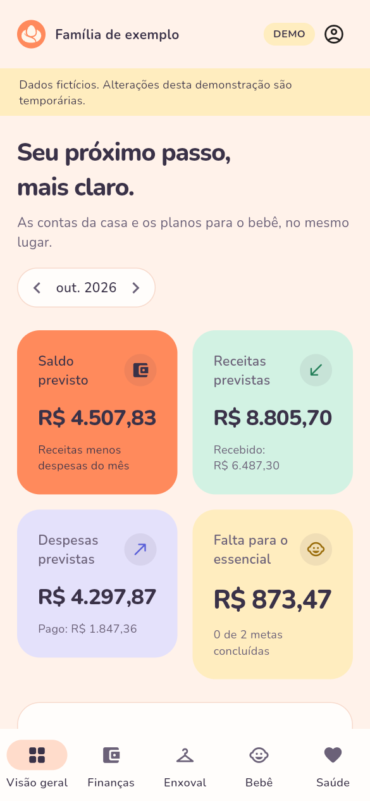
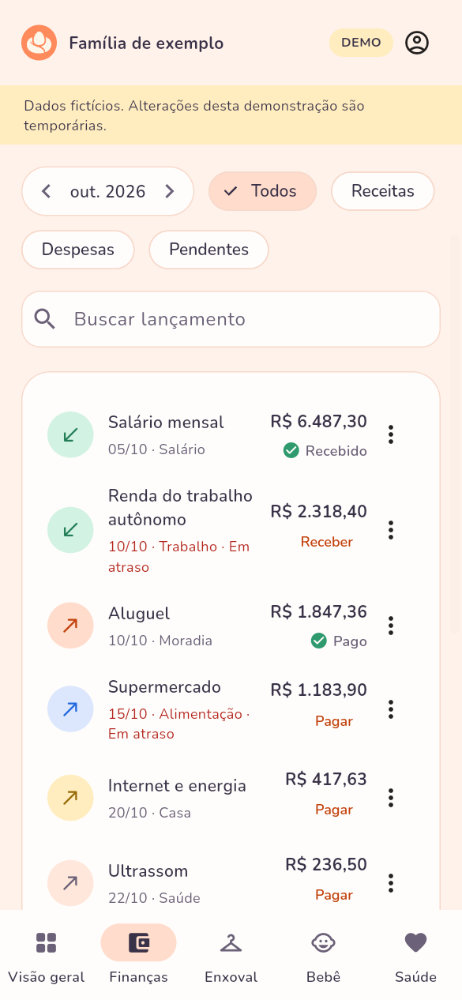
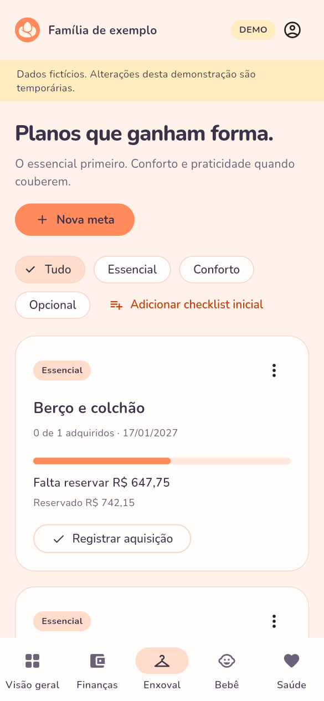
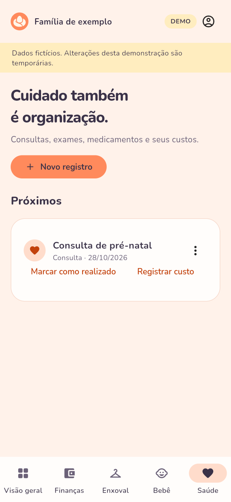
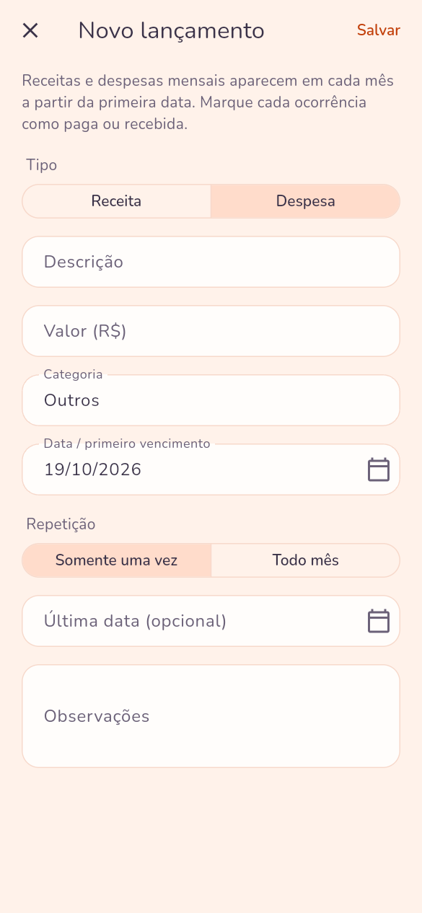
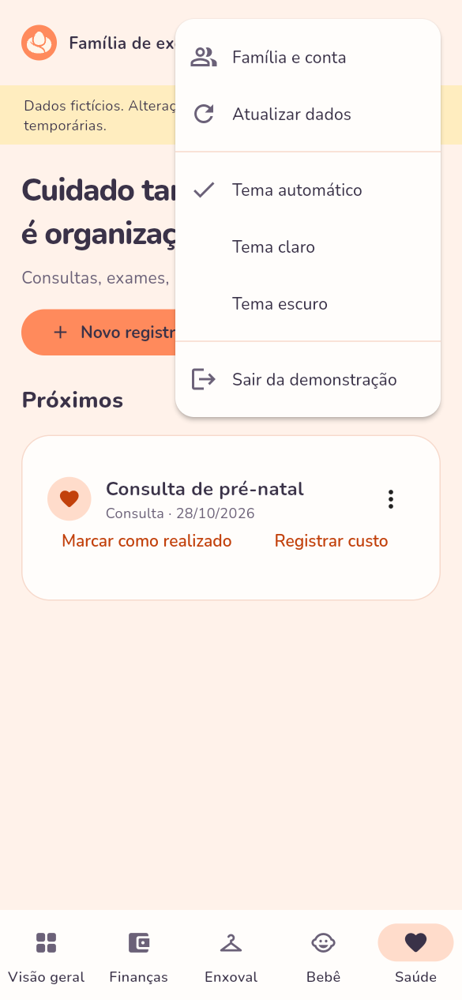
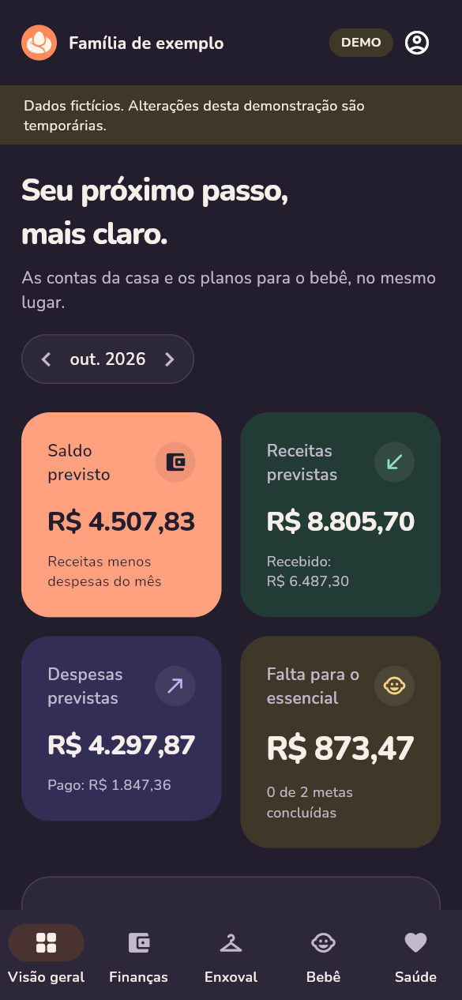
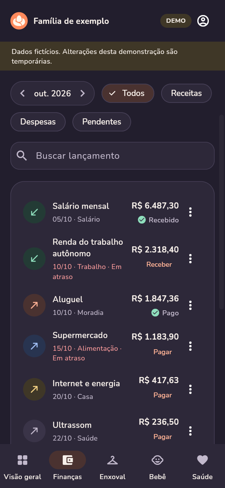
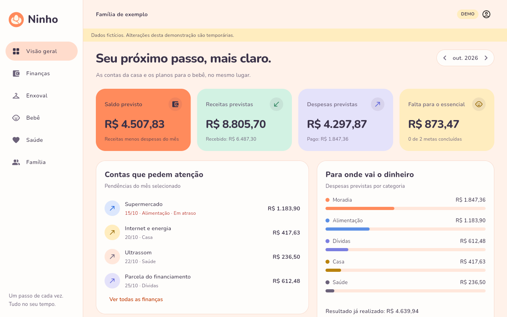

<p align="center">
  
</p>

<h1 align="center">Ninho</h1>

<p align="center">
  <strong>Planejamento financeiro e acompanhamento da família na chegada de um bebê.</strong><br>
  Contas da casa, enxoval, saúde e crescimento do bebê, num lugar só e com quem cuida junto.
</p>

<p align="center">
  
</p>

O Ninho é um app Flutter para Android e web. Os dados ficam no Supabase (Auth e Postgres) e passam por uma API em Go no Render. A versão web é publicada na Vercel, com a política de privacidade e a página de exclusão de conta. No Android, um anúncio na abertura mantém o app gratuito.

## Telas

<table>
  <tr>
    <td align="center"><br>Visão geral</td>
    <td align="center"><br>Finanças</td>
    <td align="center"><br>Enxoval e metas</td>
  </tr>
  <tr>
    <td align="center"><br>Saúde</td>
    <td align="center"><br>Novo lançamento</td>
    <td align="center"><br>Menu da conta</td>
  </tr>
  <tr>
    <td align="center"><br>Abertura</td>
    <td align="center"><br>Tema escuro</td>
    <td align="center"><br>Finanças, tema escuro</td>
  </tr>
</table>

<p align="center">
  <br>
  No computador, as páginas ficam numa barra lateral.
</p>

As imagens e o GIF saíram do build web da demonstração, com o Playwright. Para refazê-los depois de mudar as telas, veja [Imagens do README](#imagens-do-readme).

## O que o app faz

- **Finanças:** receitas, salários, despesas únicas e contas mensais com início e fim. Cada ocorrência é paga ou recebida separadamente. O valor pago fica guardado, e o pagamento pode ser desfeito pelo aviso logo depois ou pelo menu da conta. Há filtros, busca, saldo previsto e realizado, gráfico de despesas por categoria e cadastro de dívidas. Vencimentos nos dias 29 a 31 caem no último dia dos meses mais curtos.
- **Enxoval e metas:** itens por prioridade (essencial, conforto ou opcional), com orçamento, reserva, quantidade e presentes. Uma compra registra a aquisição e a despesa na mesma transação do banco.
- **Bebê:** um ou mais bebês, com data prevista ou de nascimento, peso e comprimento, e gráfico da evolução.
- **Saúde:** consultas, exames, vacinas, medicamentos e outros registros. Os próximos aparecem separados dos realizados, e o custo vira despesa sem duplicar.
- **Família:** cada pessoa entra com a própria conta, por um convite de uso único válido por 72 horas. São até quatro pessoas por família. Quem criou a família pode remover pessoas, e as outras podem sair.
- **Conta e privacidade:** cadastro com confirmação de e-mail, login e troca de senha. A conta pode ser excluída no próprio app, em Família › Sua conta, e uma página do site explica como fazer. As famílias com outras pessoas passam para quem entrou primeiro, e as demais são apagadas com seus registros. O app tem uma página de licenças de código aberto.
- **Anúncios (só no Android):** um anúncio do AdMob na abertura, no máximo a cada 4 horas, depois do consentimento do Google. A versão web não tem anúncios.

## Experiência

- **Visual:** tema claro em tons pastel, escuro em "pastel noturno" e automático (segue o sistema). A escolha fica salva no aparelho. A logo Abraço e as regras de uso estão em `branding/`. A fonte é a Nunito, embutida no app.
- **Movimento:** a abertura mostra a logo, na web e no Android, e passa para o app sem salto. As páginas trocam com um fade, e os formulários longos sobem da parte de baixo da tela. As barras crescem até o valor, e o "Pago" aparece no lugar do botão. Tudo fica imediato quando o sistema pede menos animação.
- **Acessibilidade:** com o leitor de tela, cada lançamento é lido como um item, os títulos são cabeçalhos e os botões dizem de qual registro são. Os textos têm contraste AA e os ícones, pelo menos 3:1. O layout aguenta texto ampliado.
- **Navegação:** no celular, são cinco abas e um menu da conta com família, tema e saída. No computador, uma barra lateral. O botão voltar do Android volta para a aba anterior.
- **Formulários:** no celular, os longos ocupam a tela toda. As datas aparecem em dd/mm/aaaa, a tecla do teclado passa para o próximo campo, e voltar com alterações pede confirmação.

## Experimente

Sem configuração, a tela inicial oferece só uma demonstração, com dados fictícios em memória. Nada é salvo.

```bash
cd app
flutter pub get
flutter run -d chrome
```

Para ver o build de produção, como no site:

```bash
cd app
flutter build web --release --no-web-resources-cdn
python -m http.server 8080 --directory build/web
```

Abra `http://localhost:8080` e toque em **Explorar demonstração**.

## Arquitetura

```text
App Flutter (Android e web)
  ├─ login, cadastro e senha ──> Supabase Auth
  └─ dados da família ─────────> API Go (Render) ──> Supabase Postgres, isolado por família (RLS)

Site (Vercel): build web do app, política de privacidade e exclusão de conta
```

```text
app/                  App Flutter para Android e web
backend/              API Go, só com a biblioteca padrão
supabase/migrations/  Schema, políticas de acesso e operações atômicas
supabase/tests/       Testes de isolamento e regras do banco
scripts/              Build web para a Vercel
.github/workflows/    Testes e builds de demonstração
docs/                 Publicação, Google Play, estado da validação e imagens do README
branding/             Logo, vetores e ícone da Google Play
render.yaml           Serviço da API
vercel.json           Publicação web
```

## Desenvolvimento

Requisitos: Flutter **3.47.7**, Go **1.27.2**, Android Studio (Android SDK e Java 17 ou mais novo) para Android e um projeto Supabase. A versão do Flutter fica fixada no build e na integração contínua, e o `pubspec.lock` acompanha o código.

1. Aplique as migrações de `supabase/migrations/`, em ordem, em um projeto Supabase **novo e dedicado**. Elas criam tabelas no schema público, e cada uma deve ser aplicada uma vez. Com a CLI autenticada: `supabase link --project-ref SEU_REF` e `supabase db push`.
2. No Supabase Auth, configure a Site URL, as URLs de redirecionamento permitidas e o SMTP antes de distribuir convites e cadastros. A confirmação de e-mail fica habilitada. Para testes locais, use `http://localhost:3000`; para a web, use a URL da Vercel. A recuperação de senha usa o fluxo PKCE padrão do `supabase_flutter`: o link do e-mail só conclui a troca no mesmo navegador em que ela foi pedida. O Android ainda não abre esses links, então peça a recuperação pela versão web.
3. Copie `backend/.env.example` para `backend/.env` e preencha a URL, a chave **publishable/anon** e as origens exatas. A chave secreta (`SUPABASE_SECRET_KEY`) só serve para excluir contas; sem ela, a API funciona com essa operação desligada. Ela nunca vai para o app nem para o build web.
4. Inicie a API:

   ```bash
   cd backend
   set -a
   source .env
   set +a
   go run ./cmd/api
   ```

5. Copie `app/config.example.json` para `app/config.local.json`, que o Git ignora. Para a web local, use `API_URL` igual a `http://localhost:8080`. `SITE_URL` é o endereço da versão web, que o Android usa nos links da política de privacidade. `ADMOB_APP_ID` e `ADMOB_APP_OPEN_ID` ficam vazios até existir uma conta do AdMob (veja `docs/play-store.md`).

   ```bash
   cd app
   flutter pub get
   flutter run -d chrome --web-port 3000 --dart-define-from-file=config.local.json
   ```

## Android

```bash
cd app
flutter build apk --debug --dart-define-from-file=config.local.json
```

Saída: `app/build/app/outputs/flutter-apk/app-debug.apk`, um instalador de testes assinado com a chave de desenvolvimento.

Builds de debug mostram o anúncio de abertura de teste do Google. Para a Play, gere o pacote assinado com `flutter build appbundle --release --dart-define-from-file=config.local.json`. O application ID é `br.com.ninho.app` e não pode mudar depois do primeiro envio. Configure a chave de envio em `key.properties`; o projeto não inclui chave privada.

O roteiro completo, com AdMob e os formulários do Play Console, está em `docs/play-store.md`. Não envie ao Git keystores, senhas nem IDs reais do AdMob.

## Segurança e dados

A API valida a sessão no Supabase Auth e encaminha o token do usuário ao Data API, usando só a chave pública para os dados. A única exceção é a exclusão de conta. Com a `SUPABASE_SECRET_KEY`, que fica só no Render, a API chama a API admin do Auth para apagar o usuário da sessão verificada, nunca um ID vindo da requisição. Um gatilho no banco decide, na mesma transação, o destino das famílias que a pessoa criou.

O banco aplica Row Level Security por família, mesmo que o Data API seja chamado diretamente com a chave pública e o token. Por isso, a barreira não é a lista de campos da API Go. O banco limita, por coluna, o que o cliente pode inserir e alterar. Os RPCs de compartilhamento e as operações atômicas conferem explicitamente quem é membro e quem criou a família. Relacionamentos compostos impedem ligar bebê, medidas e gastos entre famílias diferentes. As migrações também retiram privilégios padrão do Supabase que o app não usa.

Valores em dinheiro são guardados em centavos inteiros. Os registros de pagamento guardam o valor da baixa. Os logs da API não registram tokens, nomes, valores nem informações médicas. A versão web serve do próprio site os arquivos do Flutter e só acessa o Google para baixar fontes de emojis, como a política de privacidade explica.

## Validação

```bash
cd backend
go vet ./...
go test -race ./...
cd ../app
dart format --output=none --set-exit-if-changed lib test
flutter analyze
flutter test
flutter build web --release --no-web-resources-cdn
```

O que foi executado em cada entrega, com o resultado, está em `docs/validation.md`.

## Situação atual

**Verificado:**
- A análise do Flutter termina sem avisos, e passam os testes do app, da API e do banco.
- A demonstração foi conferida no navegador em várias larguras, nos temas claro e escuro.

**Pendente:**
- O build do Android e o teste em aparelho, porque a máquina de desenvolvimento não tem Android SDK.
- Provisionar o Supabase, o Render e a Vercel e testar com dados reais.
- O GitHub Actions não roda nos repositórios privados desta conta.
- Os itens da Google Play em `docs/play-store.md`.

Esta é a primeira versão, para validar o produto. Ainda não estão implementados:
- cobrança de assinatura e webhooks de pagamento;
- emissão fiscal e atendimento;
- auditoria de alterações e exportação de dados;
- notificações push e anexos.

Não há integração bancária nem sincronização offline.

O saldo da dívida é informado à mão. As parcelas entram como despesas em Finanças, e o app não calcula juros nem amortização. O saldo previsto é o resultado do mês (receitas menos despesas), não um saldo bancário. A reserva de uma meta é um valor separado à mão, não uma transferência. Os registros de saúde são informativos e não produzem diagnóstico, dose nem interpretação de exames.

Antes de abrir para outras famílias:
- validar os testes no projeto publicado;
- revisar Auth e SMTP;
- revisar a política de privacidade com apoio jurídico;
- implementar a exportação de dados;
- configurar backup e observabilidade.

O limite de requisições da API fica em memória por instância. Com várias instâncias, ele precisa ser compartilhado.

## Imagens do README

As capturas em `docs/media/` e o GIF `docs/media/demonstracao.gif` vêm do build web da demonstração, servido localmente e aberto com o [Playwright](https://playwright.dev) no Edge:
- capturas em 390 × 844 px, com escala 1,5;
- captura de computador em 1280 × 800 px;
- GIF a partir de um vídeo do Playwright, convertido com o ffmpeg: `fps=12`, 360 px de largura e paleta de 160 cores.

## Documentos

- [`docs/validation.md`](docs/validation.md): o que foi executado e o que falta.
- [`docs/deploy.md`](docs/deploy.md): publicação no Supabase, no Render e na Vercel.
- [`docs/play-store.md`](docs/play-store.md): roteiro da Google Play e do AdMob.
- [`branding/LEIA-ME.md`](branding/LEIA-ME.md): logo, cores e regras de uso.
- [`app/web/privacidade.html`](app/web/privacidade.html) e [`app/web/excluir-conta.html`](app/web/excluir-conta.html): política de privacidade e exclusão de conta.
